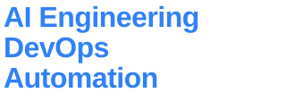
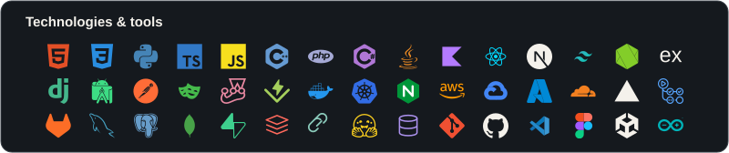

<table width="100%" border="1" cellspacing="0" cellpadding="10">
  <tr>
    <td width="56%" align="left" valign="middle">
      
    </td>
    <td rowspan="2" width="44%" align="center" valign="middle">
      
    </td>
  </tr>
  <tr>
    <td align="left" valign="middle">
      <h3>QA Engineer Intern</h3>
      Bayani Technology Solutions Inc. &#183; Manila, Philippines 
      September 2026 - November 2026
      <h3>Co-founder &amp; Software Engineer</h3>
      SEEGLA &#183; Makati, Philippines 
      March 2026 to Present
    </td>
  </tr>
  <tr>
    <td align="left" valign="middle">
      <h3>2x Hackathon Winner</h3>
      
      
      <a href="https://www.linkedin.com/in/john-rey-calipes-059187351/" title="LinkedIn profile"><picture><source media="(prefers-reduced-motion: reduce)" srcset="./assets/social/linkedin.svg" /></picture></a>
      <a href="https://www.facebook.com/john.rey.707680/" title="Facebook profile"><picture><source media="(prefers-reduced-motion: reduce)" srcset="./assets/social/facebook.svg" /></picture></a>
      <a href="https://instagram.com/devyaji_" title="Instagram profile"><picture><source media="(prefers-reduced-motion: reduce)" srcset="./assets/social/instagram.svg" /></picture></a>
      
    </td>
    <td align="left" valign="middle">
      
    </td>
  </tr>
</table>

<picture>
  <source media="(max-width: 600px)" srcset="./assets/technologies-mobile.svg" />
  
</picture>

