

<a href="https://devyaji.tech">
  <picture>
    <source media="(max-width: 600px)" srcset="./assets/banner-mobile.svg" />
    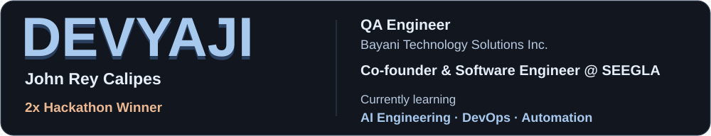
  </picture>
</a>

 

  <a href="https://devyaji.tech">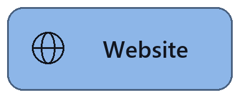</a>
  
  <a href="https://www.linkedin.com/in/john-rey-calipes-059187351/">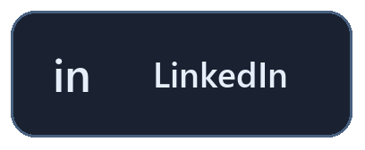</a>
  
  
  <a href="https://twitter.com/jayeeboy">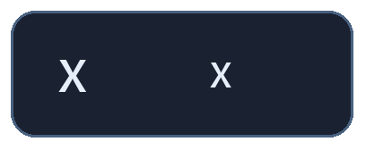</a>

<h2>Technologies &amp; tools</h2>

Software development, quality assurance, cloud, and data.

<h3>Languages</h3>

  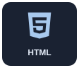
  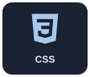
  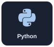
  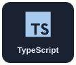
  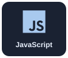
  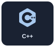
  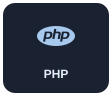
  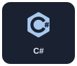
  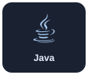
  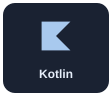

<h3>Web and mobile</h3>

  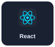
  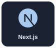
  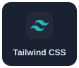
  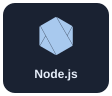
  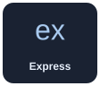
  
  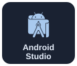

<h3>QA and testing</h3>

  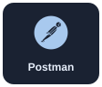
  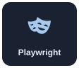
  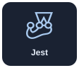
  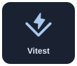

<h3>Cloud and delivery</h3>

  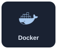
  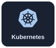
  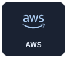
  
  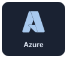
  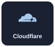
  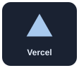
  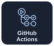
  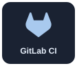

<h3>Data and AI</h3>

  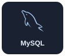
  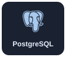
  
  
  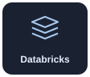
  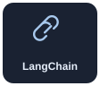
  
  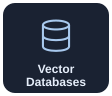

<h3>Development and creative tools</h3>

  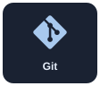
  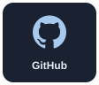
  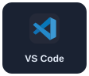
  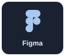
  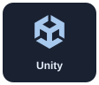
  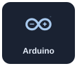

 

<a href="https://devyaji.tech">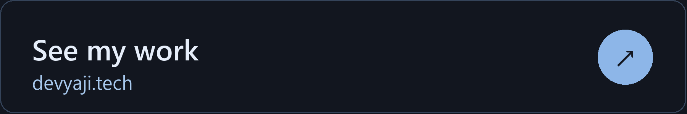</a>

<a href="https://github.com/openyaji?tab=repositories">Browse my GitHub repositories</a>

